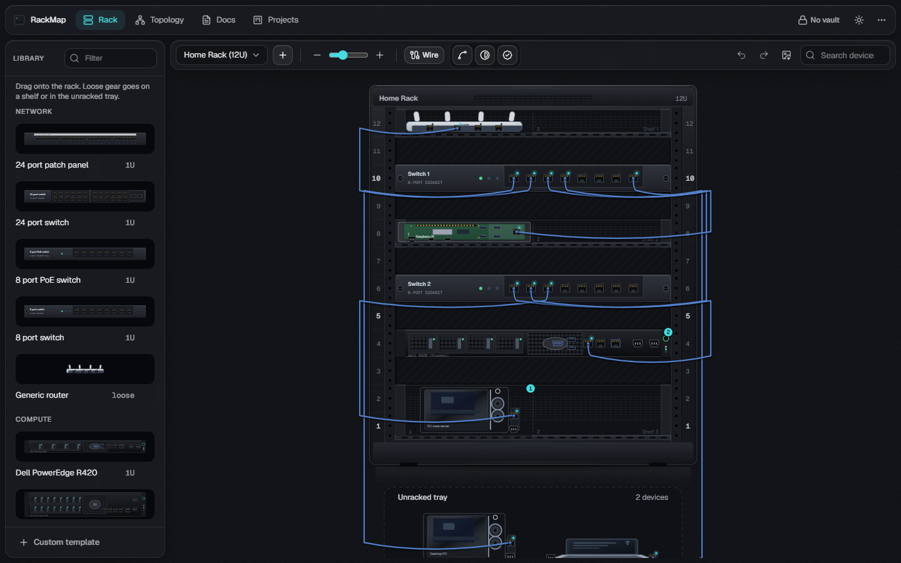
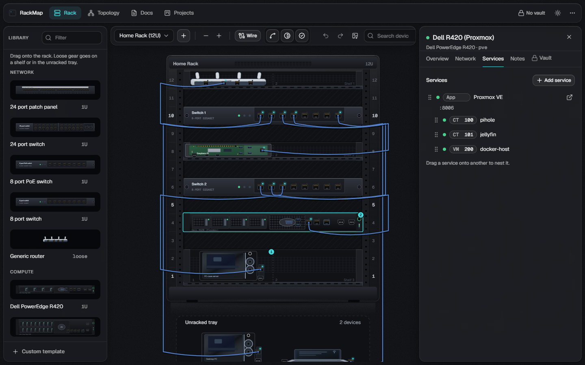
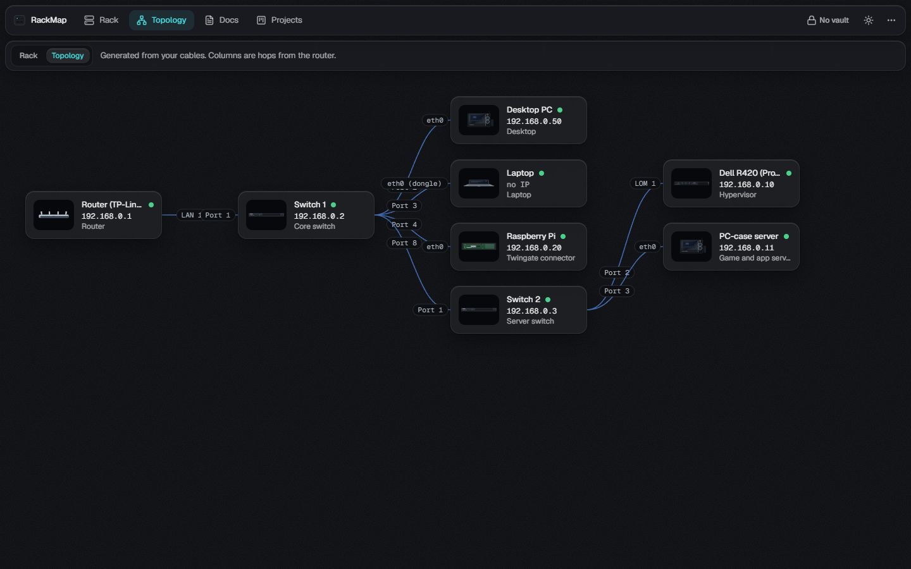
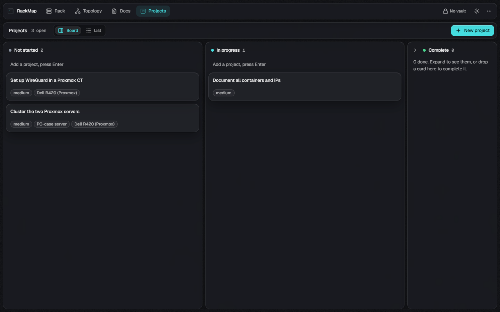

# RackMap

A single-user, self-hosted documentation app for a homelab. The main screen is an illustrated 19" rack: place devices in rack units or on shelves, wire specific ports together, and click any device for its IPs, VMs and containers, notes and an encrypted credential vault. A topology view, a Docs area and a Projects board are generated from the same data.



| Device drawer | Topology | Projects |
| --- | --- | --- |
|  |  |  |

## Features

- **Rack view:** realistic cabinet with rails, U gutters and blanking panels, hand-drawn SVG illustrations, link LEDs, and drag and drop from a device library. Shelves hold loose gear, and an unracked tray holds everything else. Includes undo/redo, keyboard control, a context menu, and PNG/SVG export.
- **Wiring:** wire mode, port-to-port cables routed through side lanes with a gentle sag, tooltips, a cable inspector, and validation (one cable per port, no self-links, a warning on speed mismatch).
- **Device drawer:** Overview (with linked projects), Network (ports, IPs, VLANs, duplicate and subnet warnings), Services (VM/LXC/Docker tree), Markdown notes, and the Vault.
- **Vault:** zero-knowledge at rest. Argon2id key derivation, an XChaCha20-Poly1305 data key, a 24-word recovery phrase, auto-lock, a 15 s reveal, TOTP codes and a password generator.
- **Topology:** a layered tree from the router outwards.
- **Docs:** global search, IP plan, printable inventory, global notes and VLANs.
- **Projects:** a kanban board and list view, linked to devices and services or standalone, with checklists.
- **Operations:** JSON export and restore, nightly backups with 14-day retention, an audit log, and a dark glass theme (with a light variant).

## Stack

React 18, TypeScript, Vite, Tailwind (driven by design tokens in `apps/web/src/styles/tokens.css`), Zustand, React Router, Lucide icons and Geist fonts in `apps/web`. Node 20, Express and Drizzle ORM on PostgreSQL 16 in `apps/api`. Shared Zod schemas in `packages/shared`. libsodium for all cryptography. Design decisions and assumptions are in [DECISIONS.md](DECISIONS.md).

## Develop

```bash
npm install
npm run dev:api        # API on :3000. Without DATABASE_URL it uses embedded PGlite (set PGLITE_DIR=./data/pglite to persist)
npm run dev:web        # Vite on :5173, proxies /api to :3000
npm run lint && npm run typecheck && npm test && npm run build
```

On first run the API loads the sample **Home Rack** lab (remove it from Settings → Sample data). Open the app and set the app password. The setup screen appears only once.

## Deploy with CapRover

RackMap runs as one container (the API serves the built web app). **It needs no configuration:** with nothing set, it uses a built-in Postgres-compatible database and a generated session secret, both kept in `/data`. The only requirement is that `/data` is a persistent directory.

1. **App:** create an app called `rackmap` and tick *Has Persistent Data*. Under *App Configs → Persistent Directories*, map the path in the app `/data` to a label such as `rackmap-data`. That folder holds the database, the session secret and the nightly backups. If `/data` is not a volume, the logs warn that data will be lost on redeploy.
2. **Optional, a separate PostgreSQL 16:** for a dedicated database, go to *One-Click Apps/Databases → PostgreSQL* (version 16) and set `DATABASE_URL` as shown below. Without it, the built-in database in `/data/pglite` is used.
3. **Environment variables** (*App Configs*), all optional:

   | Variable | Default | Notes |
   | --- | --- | --- |
   | `DATABASE_URL` | unset, which uses the built-in database in `/data/pglite` | e.g. `postgres://rackmap:<pw>@srv-captain--rackmap-db:5432/rackmap` |
   | `SESSION_SECRET` | generated once and stored in `/data/session-secret` | Set your own (32+ characters) if you prefer. Changing it signs everyone out. |
   | `COOKIE_SECURE` | `auto` | `auto` marks cookies Secure when the request arrived over HTTPS, so plain `http://server:port` works too. Set `true` to force it once you only use HTTPS. |
   | `DATA_DIR` | `/data` | Root for the database, secret and backups. |
   | `PORT` | `80` | The container's HTTP port (CapRover default). |
   | `BACKUP_DIR` | `/data/backups` | Nightly JSON backups (03:00 server time). |
   | `BACKUP_RETENTION_DAYS` | `14` | Older nightly files are deleted. |
   | `BACKUPS_ENABLED` | `true` | `false` disables the nightly job. |
   | `SKIP_SEED` | `false` | `true` skips loading the sample lab on first start. |
   | `PGLITE_DIR` | `/data/pglite` | Where the built-in database lives when `DATABASE_URL` is unset. |

4. **Deploy:** from a clone of this repo run `caprover deploy` (it uses `captain-definition` and the `Dockerfile`), or upload a tarball in the CapRover UI. Migrations run automatically on start.
5. **Health:** CapRover can watch `GET /healthz`, which returns `200` without authentication.
6. **Reverse proxy:** in Nginx Proxy Manager, add a proxy host (for example `rackmap.lab.internal`) pointing at the CapRover app. Enable SSL with your internal certificate and turn on *Websockets* (harmless, future-proof). Do not expose it to the internet.
7. **Remote access:** add the proxy host's address as a Twingate resource. Users then reach RackMap over Twingate exactly as on the LAN.

Then open the site, set the app password, and set up the vault from **Settings → Vault** (a separate master password of at least 14 characters). Write the 24-word recovery phrase down: it is shown once.

### Security notes

- The app password and the vault master password are separate. A stolen session cookie alone never exposes secrets.
- Passwords, TOTP seeds and private notes are encrypted with a data key that only the master password or recovery phrase can unwrap. **Usernames, IPs, URLs and ordinary notes are stored in plain text.**
- Losing both the master password and the recovery phrase makes the secrets unrecoverable.
- Login is limited to 5 attempts per 15 minutes per IP, with backoff. Sessions last 12 hours idle and 7 days at most. CSRF protection and a strict CSP are always on.

## Backups

See [docs/backup-restore.md](docs/backup-restore.md) for the runbook.

## Project layout

```
apps/web        React SPA (components/rack, cables, drawer, vault, topology..., illustrations/, store/, routes/)
apps/api        Express API (routes/, services/, db/ schema + migrations + seed, crypto/, middleware/, tests/)
packages/shared Zod schemas, enums and response types
docs/           Runbook and screenshots
```
